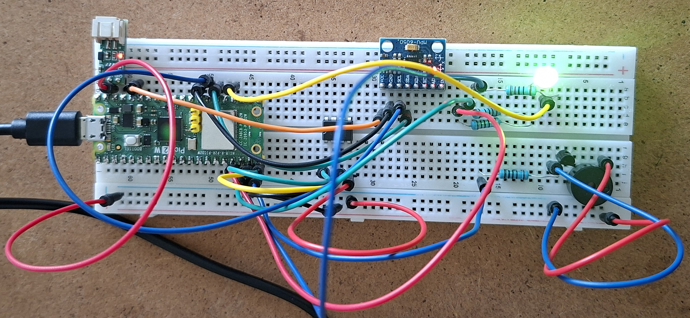
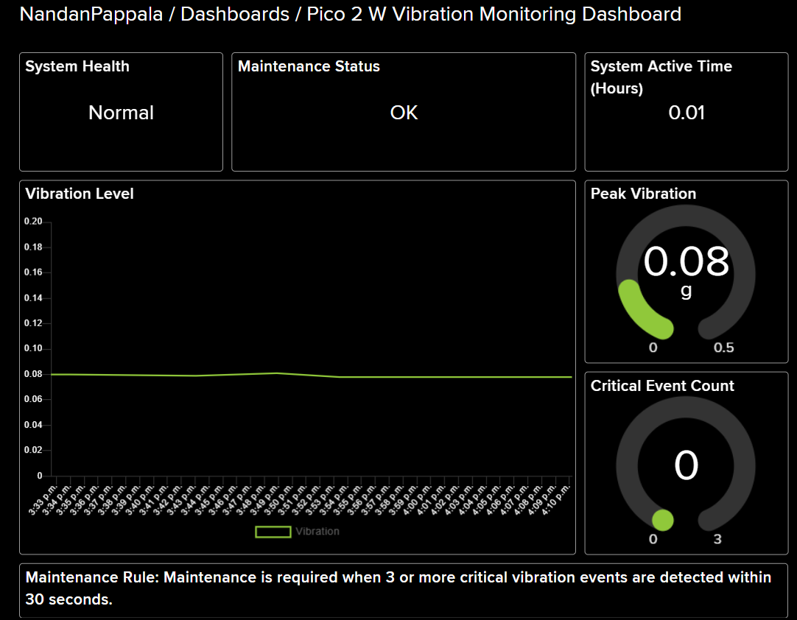
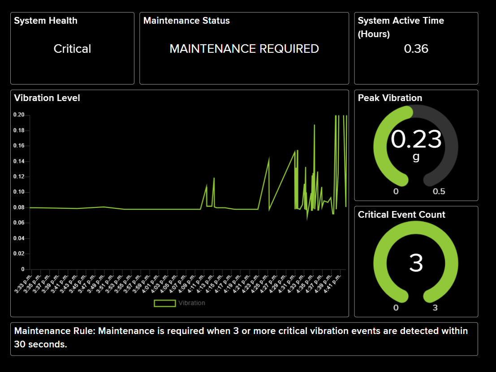
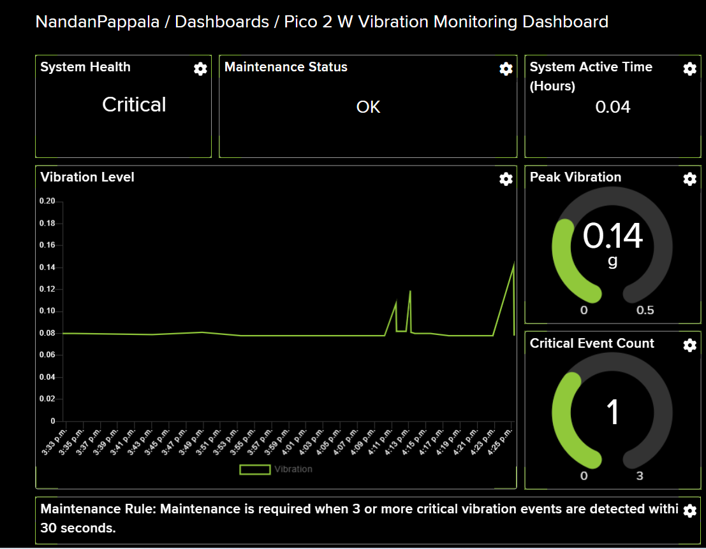
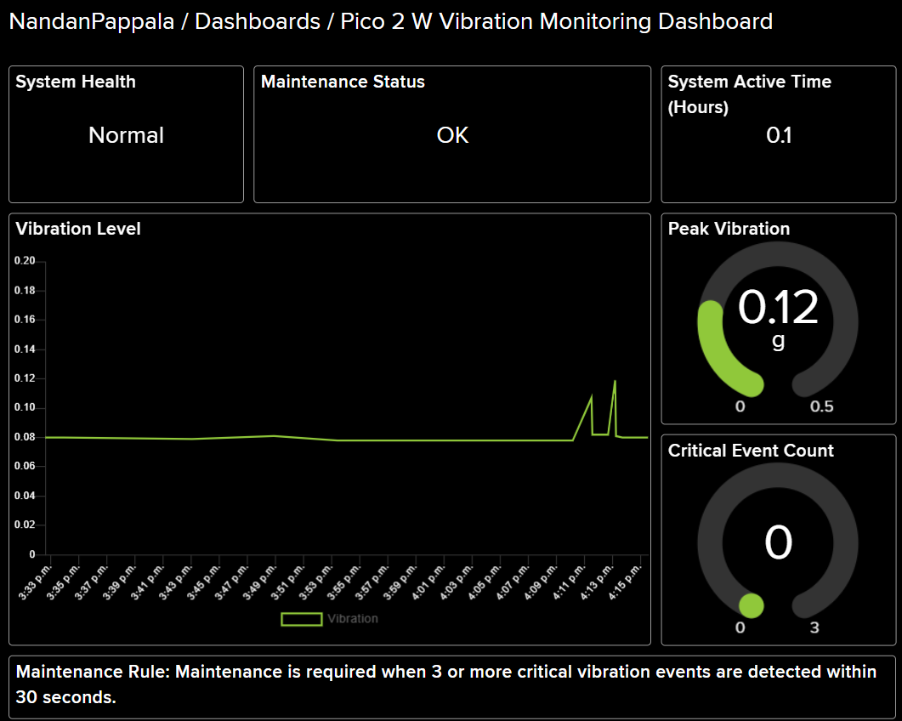

# Smart Vibration Monitoring System
A Grade 12 passion project by Nandan Pappala that uses a Raspberry Pi Pico 2 W and MPU6050 sensor to monitor vibration levels and provide early maintenance alerts through an Adafruit IO dashboard.

---

## About the Project

This project monitors vibration in real time using an MPU6050 accelerometer connected to a Raspberry Pi Pico 2 W.

When the system starts, it collects vibration data for 30 seconds to determine a normal operating level. Future readings are compared with this level to identify unusual vibrations.

The system can:

- Monitor vibrations in real time
- Detect unusual vibration activity
- Display system health status
- Turn on LED and buzzer alerts when unusual vibrations are detected
- Track vibration trends
- Recommend maintenance through an IoT dashboard

---

## Features

- Monitors vibrations in real time
- Detects unusual vibration activity
- Shows system health status
- Tracks vibration levels and peaks
- Alerts users when vibration becomes excessive
- Recommends maintenance when needed
- Displays live data on an Adafruit IO dashboard
- Supports remote monitoring through Wi-Fi

---
## System Architecture

```text
MPU6050 Sensor
       ↓
Raspberry Pi Pico 2 W
       ↓
     Wi-Fi
       ↓
Adafruit IO Dashboard
       ↓
System Status
```

---

## How It Works

1. The MPU6050 measures vibration levels.
2. The Pico 2 W performs a 30-second startup calibration.
3. A baseline vibration level is calculated.
4. New readings are compared to the baseline.
5. The system classifies conditions as:
   - Normal
   - Warning
   - Critical
6. Critical events are counted.
7. Maintenance is recommended if 3 or more critical events occur within 30 seconds.
8. Data is sent to Adafruit IO for remote monitoring.

---

## Components Used

- Raspberry Pi Pico 2 W
- MPU6050 Accelerometer
- LED
- Buzzer
- Breadboard
- Jumper Wires
- Wi-Fi Connection
- Adafruit IO

---

## Dashboard

The Adafruit IO dashboard displays:

- System Health
- Maintenance Status
- System Active Time
- Vibration Level
- Peak Vibration
- Critical Event Count
---  
## Project Gallery

### Hardware Setup
Complete breadboard assembly with the Raspberry Pi Pico 2 W, MPU6050 sensor, LED, and buzzer.



---

### Dashboard - Normal Operation
System operating under normal vibration conditions.



---

### Dashboard - Maintenance Alert
Dashboard displaying a maintenance alert after multiple critical vibration events.



---

### Vibration Monitoring
Real-time vibration data and critical event count displayed on the Adafruit IO dashboard.



---

### Peak Vibration
Highest vibration value detected by the system.



---
## Results


The project successfully monitored vibration levels, detected unusual activity, and displayed live data on an Adafruit IO dashboard. It also demonstrated how sensors, microcontrollers, and IoT technologies can work together to support real-time monitoring.

---


## What I Learned

Building this project helped me improve my skills in programming, electronics, and IoT systems. I learned how to connect sensors to a microcontroller, send data to the cloud, and display real-time information on a dashboard.

Most importantly, I learned how technology can be used to solve practical problems through data collection and monitoring.


---

## Future Improvements

- Mobile app integration
- Support for additional sensors
- Smarter vibration analysis

---

## Demo Video

Add your YouTube or GitHub video link here.

---

## Disclaimer

This project was developed as a Grade 12 passion project for educational purposes. It demonstrates vibration monitoring, condition monitoring, and maintenance alert concepts using a Raspberry Pi Pico 2 W and MPU6050 sensor.
